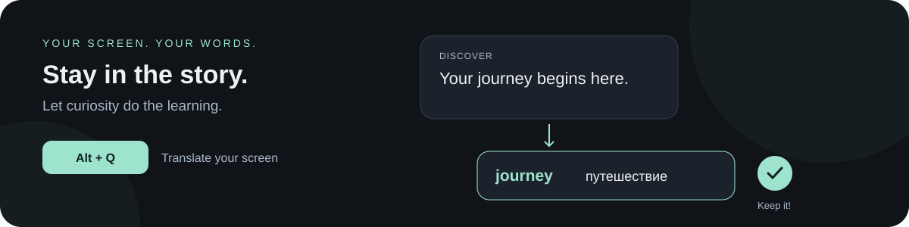
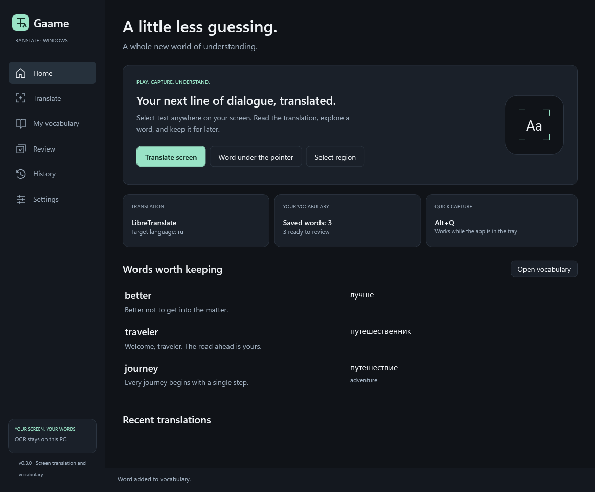
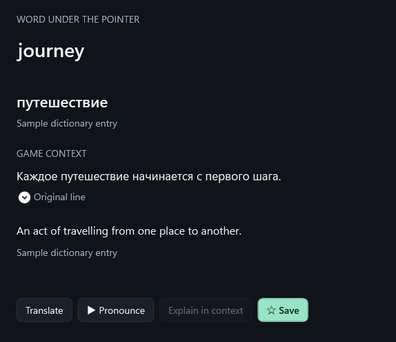
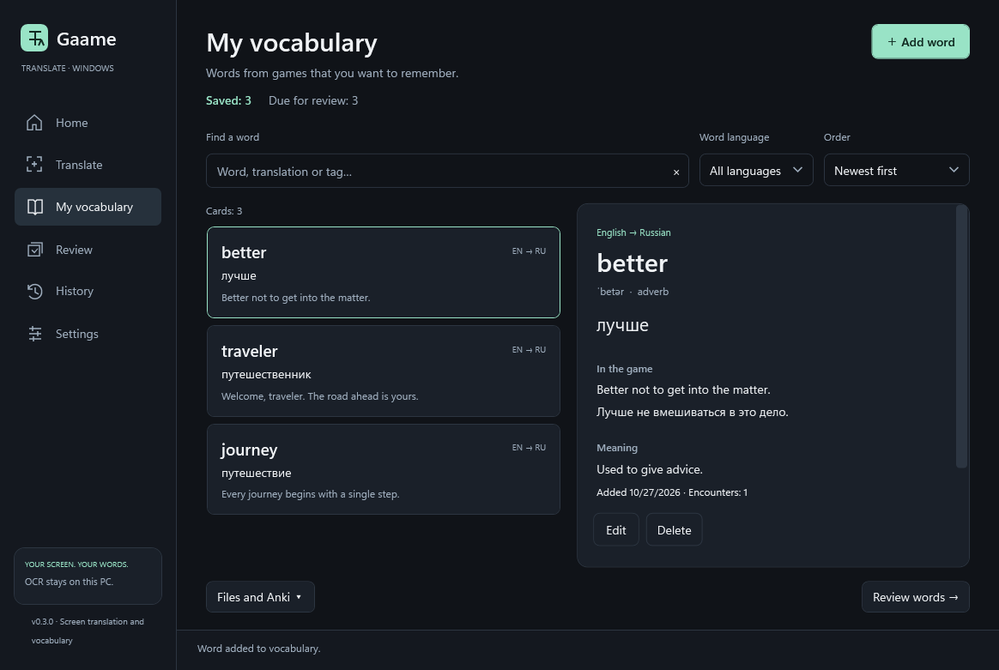
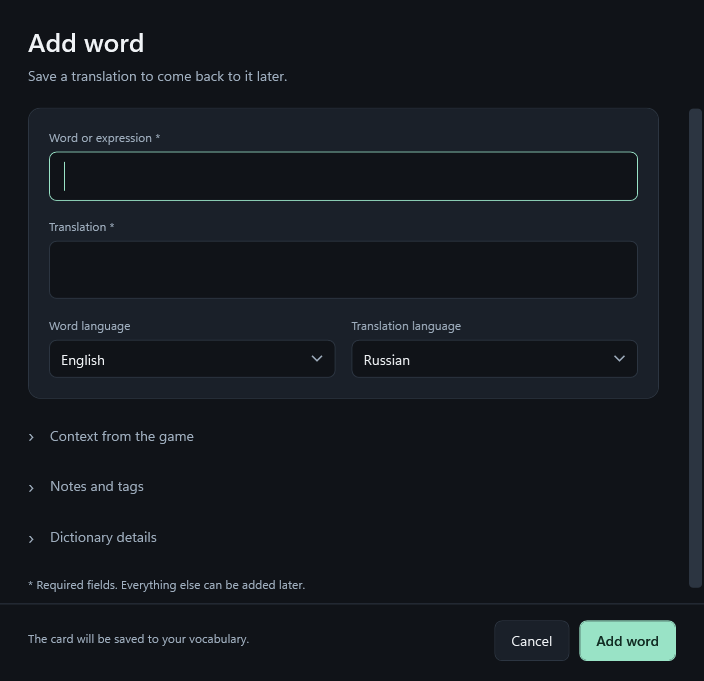
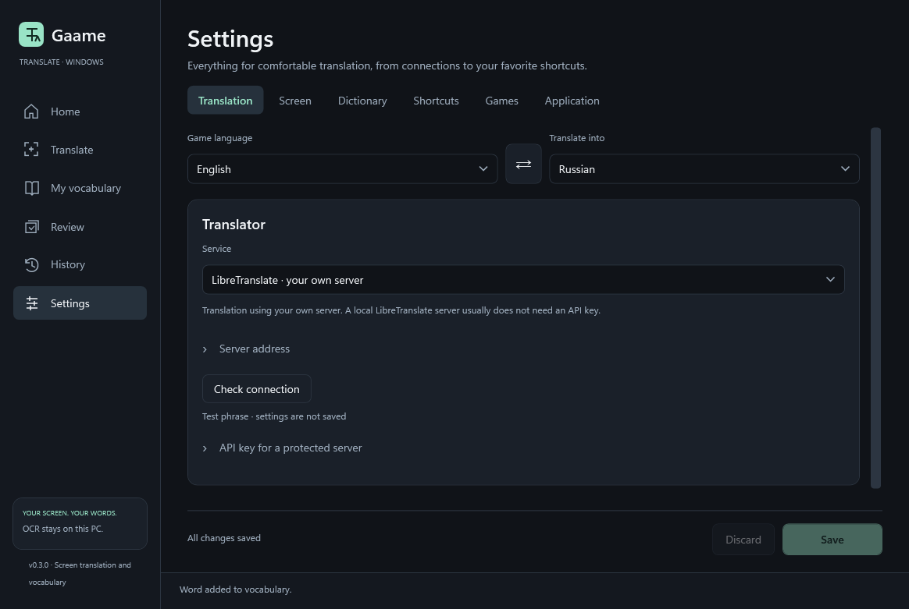

<div align="center">

# GaameTranslate

**Enjoy the game. Understand the dialogue. Keep the words you love.**

A screen translator and vocabulary companion for Windows.

Windows 11 · English / Русский · Local & cloud translation

[Get started](#-your-first-translation) · [Take a look](#-a-little-tour) · [Choose a translator](#-choose-your-translator)



</div>

## 👋 Meet your gaming companion

An unfamiliar word shouldn't interrupt a good story. Press **Alt+Q** to translate the screen, or point at a word and press **Alt+W** to explore it. Want to remember it? Save it with the sentence it came from and come back for a quick review later.



## 🚀 Your first translation

1. **Unzip and open** `GaameTranslate.exe`. Keep the extracted files together — no separate .NET installation needed.
2. **Pick your translator** in **Settings → Translation**. Enter its connection details and choose your languages.
3. **Check connection → Save**, then open your game and try **Alt+Q**.

That's it! Windowed or borderless games work best.

> **Prefer Russian?** Go to **Settings → Application → Interface language** and choose **Русский**. You can switch back to English anytime, without restarting.
>
> **Using LibreTranslate?** The default address is `http://127.0.0.1:5000`. Start your server first, or choose another provider in Settings.

## ✨ A little tour

### A word, with the story around it

Use **Alt+W** for a word under your cursor. The word translation arrives first; the surrounding sentence and optional AI explanation follow in the background. You can listen to pronunciation or save the word right from the popup.



*Example entries show the English interface with Russian translations.*

### Your own collection of discoveries

Keep words, context, notes, and tags together. Search your collection, edit a card, or review words with spaced repetition. Take them with you using CSV, Anki export, or AnkiConnect sync.



<details>
<summary><strong>Want to add a word yourself?</strong></summary>

You only need a word and a translation. Add context and notes whenever you like.



</details>

### Make it feel right for your games

Choose your translator, adjust the overlay, set your shortcuts, and keep separate game profiles. You can also watch a selected screen area and translate its text as it changes.



## 🌍 Choose your translator

Use a local model or connect a cloud service that works in your region.

| Want to… | Try… |
| --- | --- |
| Run a local translation server | **LibreTranslate** |
| Translate with local language models | **Ollama** or **LM Studio** through the OpenAI-compatible connector |
| Connect Yandex services | **Yandex Translate** or **YandexGPT** |
| Use another cloud provider | **GigaChat**, **Azure Translator**, **DeepL**, or an **OpenAI-compatible API** |

Cloud services need their own API credentials and quota. An optional assistant for explanations is configured separately in **Settings → Dictionary**.

<details>
<summary><strong>Set up local models with Ollama — no Docker needed</strong></summary>

Run this in PowerShell from the project or extracted app folder:

```powershell
./scripts/Start-LocalModels.ps1 -Assistant
```

The script downloads portable Ollama, TranslateGemma 4B, and Qwen3 4B. Allow several gigabytes for the download and models.

Select **Ollama** in Settings with URL `http://127.0.0.1:11434`:

- Translation: `translategemma:4b` or `qwen3:4b-instruct-2507-q4_K_M`.
- Dictionary explanations: `qwen3:4b-instruct-2507-q4_K_M`.

Run the script again after restarting Windows to start the server. Models have their own licenses; translation quality and speed depend on your hardware and chosen model.

</details>

## ⌨️ A few keys to remember

| Shortcut | What happens |
| --- | --- |
| **Alt+Q** | Translate the screen; press again to close the overlay |
| **Alt+W** | Look up the word under your cursor |
| **Ctrl+Shift+T** | Select an area to translate |
| **Ctrl+Shift+R** | Translate that area again |
| **Ctrl+Shift+O** | Show or hide the overlay |
| **Ctrl+Shift+I** | Let clicks pass through the overlay |
| **Escape** | Close the active translation window |

You can change shortcuts in Settings. To fully quit, choose **Exit** in the system tray menu.

## 🔒 Your screen, your choice

Text recognition runs on your PC. Built-in OCR supports English, Japanese, and Chinese; other explicitly selected languages use Windows OCR and may need a matching language pack.

Your vocabulary and settings stay in `%LOCALAPPDATA%\GaameTranslate`. API keys use Windows DPAPI protection; vocabulary and media files aren't encrypted. There is no telemetry. Cloud translators receive recognized text and relevant context when you request a translation, not screenshots. Saving screenshots or audio with cards is optional and off by default.

Protected content and exclusive fullscreen games may prevent capture or overlays. GaameTranslate doesn't inject code into games or read their memory.

<details>
<summary><strong>🛠️ Building from source</strong></summary>

You'll need Windows and the **.NET 10 SDK**.

```powershell
./scripts/Build.ps1 -Configuration Release -NativeVerification
./scripts/Publish.ps1
```

Find the app in `artifacts/publish/win-x64` and the ZIP in `artifacts`.

More details: [testing](docs/TESTING.md) · [release notes](docs/RELEASE-0.3.0.md) · [localization](docs/LOCALIZATION.md).

</details>

---

Built with C#, .NET 10, and WPF. See [LICENSE](LICENSE) for the app license. Imported dictionaries and downloaded models have their own licenses.
