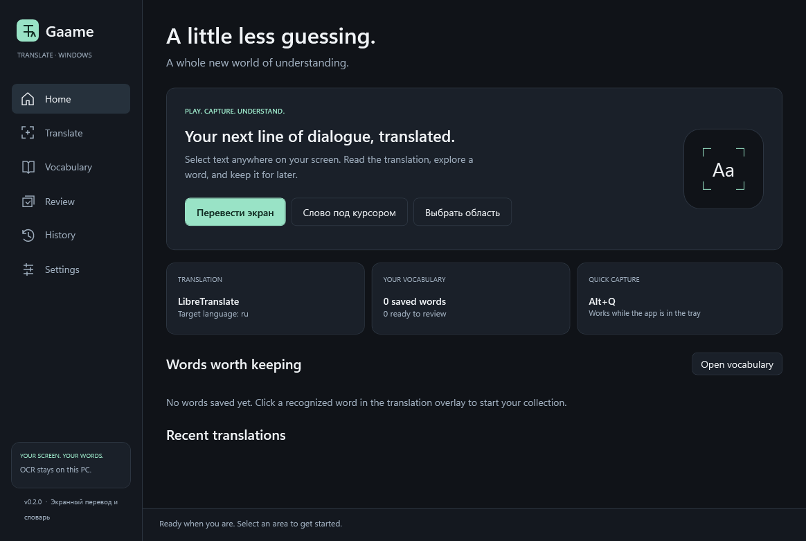

# GaameTranslate

A native Windows screen translator for games, visual novels, browsers and desktop apps. Select text, read it in an overlay, and save useful words for spaced repetition.

Built with C# / .NET 10, WPF and Windows OCR. **Translation requires your own DeepL/Azure API key or a running LibreTranslate service. No credentials, translation model or pretend translations ship with the app.**



## Start here

1. Run `GaameTranslate.exe` from the published folder. Keep the entire folder together.
2. Open **Settings → Translation**. Choose a provider, enter its key if needed, and **Save settings**.
3. Choose the matching **installed OCR language**. The Windows profile default is convenient for English, but does not detect the language of an image.
4. Press **Ctrl+Shift+T**, drag a rectangle over visible text, and release. Escape or right click cancels.
5. Click an OCR word in the floating result to translate it separately and add it to Vocabulary. For Japanese/Chinese, edit the word field or select a substring in the original text.

The default target is Russian. Change the language pair directly on Translate or in Settings.

## Implemented

- Global region, fullscreen, repeat-region, overlay and vocabulary shortcuts, including conflict detection and a shortcut recorder.
- Physical-pixel GDI screen capture; per-monitor selection windows; active/selected monitor and all-monitor captures; negative-coordinate mapping and PerMonitorV2 DPI awareness.
- Native Windows OCR with installed-language discovery, line and word bounds, reading order and optional scaling, grayscale, contrast, smoothing and thresholding. Confidence is absent because Windows OCR does not expose it.
- DeepL Free/Pro, Azure Translator and LibreTranslate adapters: batching, process-local bounded cache, cancellation, 30-second per-batch deadline, two limited retries for rate limits/server errors, safe error messages and DeepL context.
- Four displays: draggable/resizable floating result, spatial labels with collision avoidance and panel fallback, approximate original-text replacement, and a side panel. Copy, pin/unpin, Escape dismissal and native click-through toggle.
- Word lookup, editable substring selection, saved context, notes, tags, duplicate encounter counts, local SQLite storage and vocabulary search, language/date filters and sorting.
- CSV import/export, spreadsheet formula protection on CSV export, Anki TSV export, and Again/Hard/Good/Easy flashcards with persistent due dates.
- Searchable bounded text history, reopen/copy/delete/clear, local settings, account-bound DPAPI credentials, dark/light appearance, tray controls and single-instance activation.
- Capture/OCR/translation/total timing and overlay render diagnostics, without logging recognized text or keys.

## Requirements

- Windows 11 x64, interactive desktop. Windows 10 build 19041 is the API baseline; Windows 11 is the intended deployment platform.
- Installed Windows OCR packs for the text you want to recognize. In **Windows Settings → Time & language → Language & region → Language options**, install the language's OCR capability where offered, then restart GaameTranslate.
- A configured translation service. Supported languages depend independently on the installed OCR pack and the translation provider/model.
- Borderless/windowed games are the preferred use case.

Published builds include .NET. Development requires the .NET 10 SDK and a NuGet connection; Visual Studio 2026 with .NET desktop development is optional.

## Build, test and run

From PowerShell in this repository:

```powershell
./scripts/Build.ps1
dotnet run --project src/GaameTranslate.App
```

For a reproducible native verification run on an unlocked Windows desktop:

```powershell
./scripts/Build.ps1 -Configuration Release -NativeVerification
```

Or use `dotnet restore GaameTranslate.sln`, `dotnet build GaameTranslate.sln`, and `dotnet test tests/GaameTranslate.Tests`. Exit the application from its tray menu before rebuilding its output directory.

Create a self-contained Windows x64 folder and ZIP:

```powershell
./scripts/Publish.ps1
# artifacts/publish/win-x64/GaameTranslate.exe
# artifacts/GaameTranslate-0.1.0-win-x64.zip
# artifacts/GaameTranslate-0.1.0-win-x64.zip.sha256
```

The publish script pins the self-contained .NET runtime to 10.0.13; update its `-RuntimeVersion` parameter as patches are released. The ZIP is unsigned. An installer and code signing are not included. Native dependencies and runtime files belong alongside the executable; do not copy just the EXE.

For isolated development data, use `GaameTranslate.exe --data-dir "C:\path\to\test-data" --show`. A second launch activates the running instance, regardless of data directory. `--smoke-test` runs native OCR/capture/DPAPI diagnostics, writes `native-smoke.json` to the chosen data directory and exits.

## Translation services

### DeepL

Create a **DeepL API** account and obtain an API authentication key. A consumer translator subscription is not a substitute for API credentials. Select **DeepL Free** or **DeepL Pro** to match your API plan, paste the key, then Save. A blank key field preserves the saved key. Use **Delete the saved key** to remove it. The optional context hint and surrounding OCR text are sent only through DeepL's documented context field. Automatic source detection is available; English targets use `EN-US`.

Official protocol: [DeepL text translation](https://developers.deepl.com/api-reference/translate/request-translation).

### Azure Translator

Create an Azure Translator resource. Select **Azure**, enter the subscription key and the resource region from its Keys and Endpoint page. Regional/multi-service resources require the region. This implementation uses the global `api.cognitive.microsofttranslator.com` endpoint; sovereign clouds, custom endpoints, Entra authentication and custom model categories are not implemented.

Official protocol: [Azure Translator v3](https://learn.microsoft.com/en-us/rest/api/translator/translator/translate?view=rest-translator-v3.0).

### LibreTranslate / local translation

Install LibreTranslate separately with the desired language models, start its service, then select **LibreTranslate** and enter its base address, for example `http://127.0.0.1:5000`. The app appends `/translate`. Add a key only if your service requires one. HTTP is accepted for loopback addresses only; remote servers require HTTPS. Redirects are not followed. The app does not start, install or manage translation models.

Official setup and protocol: [LibreTranslate](https://docs.libretranslate.com/), [translate endpoint](https://docs.libretranslate.com/api/operations/translate/).

## Shortcuts

| Action | Default |
|---|---|
| Select region | Ctrl+Shift+T |
| Fullscreen / selected monitor | Ctrl+Shift+F |
| Repeat saved region | Ctrl+Shift+R |
| Show/hide result | Ctrl+Shift+O |
| Vocabulary | Ctrl+Shift+V |
| Toggle overlay interaction | Ctrl+Shift+I |

If a game or utility owns a shortcut, choose a different combination in Settings. Shortcuts continue while the main window is hidden. Close hides the app by default; **tray → Exit** shuts it down. Launch at Windows startup is not configured automatically.

## Data and privacy

Default data folder: `%LOCALAPPDATA%\GaameTranslate`. It contains `settings.json`, `gaametranslate.db` (and SQLite journal files), encrypted credential files and bounded `diagnostics.log` files. Vocabulary and translation history contain unencrypted text. Screenshots are processed in memory and are never stored by the application. Only requested capture runs; no continuous background capture or telemetry is implemented.

Cloud providers receive extracted text and any supported context when you request translation or word lookup. A local LibreTranslate endpoint keeps translation on your machine. Credentials are encrypted with Windows DPAPI for the current Windows user. Keys are never placed in source control or diagnostics. CSV/Anki exports contain your chosen text; protect them as personal files.

History is enabled by default, limited to 500 retained entries. Disable it or set its limit to zero to prevent future history storage; clear existing history separately. Searches display up to 500 matching translations. Use History → Clear history and Settings → Delete all vocabulary to remove local text. CSV exports use the current vocabulary view. CSV import validates the complete file before saving rows, then imports incrementally; cancelling or a disk failure can leave the already imported rows.

## Limits and verification status

- Exclusive fullscreen, protected/DRM content, remote desktops and anti-cheat overlays may block GDI capture or prevent topmost overlays. A black capture can produce “no text found.” No DLL injection, game hooks, memory access or anti-cheat bypass is used. Windows Graphics Capture is a future backend.
- Mixed DPI and negative origins are handled in the coordinate model, but physical testing in this environment used one 2560×1440 display. Multi-monitor, mixed-DPI, display disconnect and actual game behavior still require the manual matrix in [TESTING](docs/TESTING.md).
- OCR pack/model quality limits recognition. Stylized fonts, vertical Japanese, ruby/furigana, rotated text and low-resolution subtitles are not specially supported. Windows word segmentation is a starting point, not a Japanese morphological dictionary; arbitrary substring lookup is provided.
- Spatial placement is approximate; dense labels fall back to a panel. Replacement uses a solid translucent surface, with no inpainting or scene reconstruction. Translation can extend beyond the original text height.
- No live provider credentials were available during implementation. HTTP contracts/retry/cache behavior were tested with doubles; real capture, OCR, overlays, DPAPI and local persistence were exercised. Translation quality and live account/quota behavior need a configured provider.
- No continuous subtitle monitoring, automatic startup registration, installer, signed release, cloud sync, offline models bundled in the app or translation alternatives are claimed.

See [architecture](docs/ARCHITECTURE.md), [verification](docs/TESTING.md) and the [roadmap](docs/ROADMAP.md).

## Architecture

`Core` contains contracts, records, normalization, languages, coordinates, overlay placement and review scheduling. `Windows` contains GDI capture, WinRT OCR, preprocessing, monitor selection, Win32 hotkeys and DPAPI. `Infrastructure` implements HTTP translation, cache, SQLite, CSV and atomic JSON settings. `App` composes services through the .NET host, uses CommunityToolkit MVVM for application state/commands, and owns WPF presentation and tray lifecycle. The two test projects separate portable domain/infrastructure tests from Windows-native verification.

MIT licensed; see [LICENSE](LICENSE).
