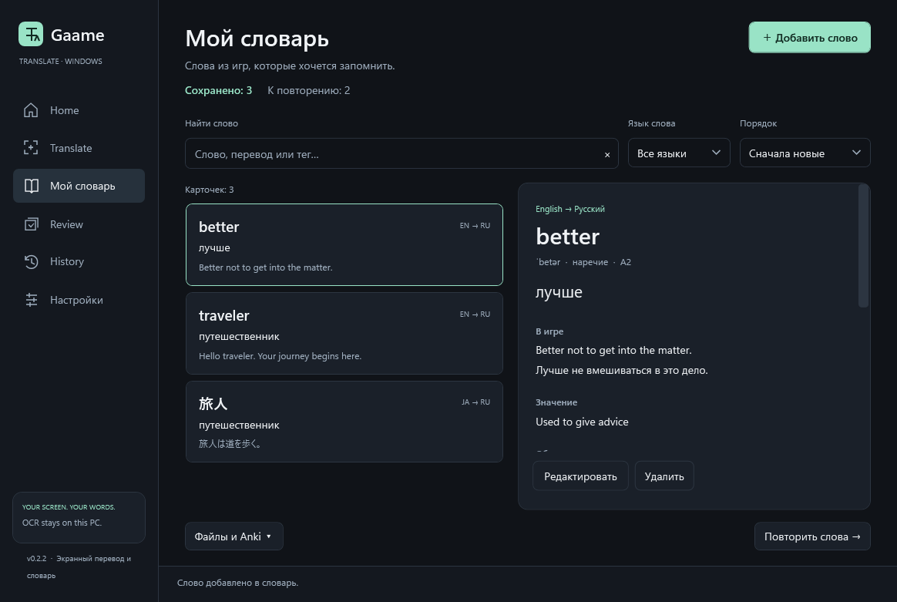
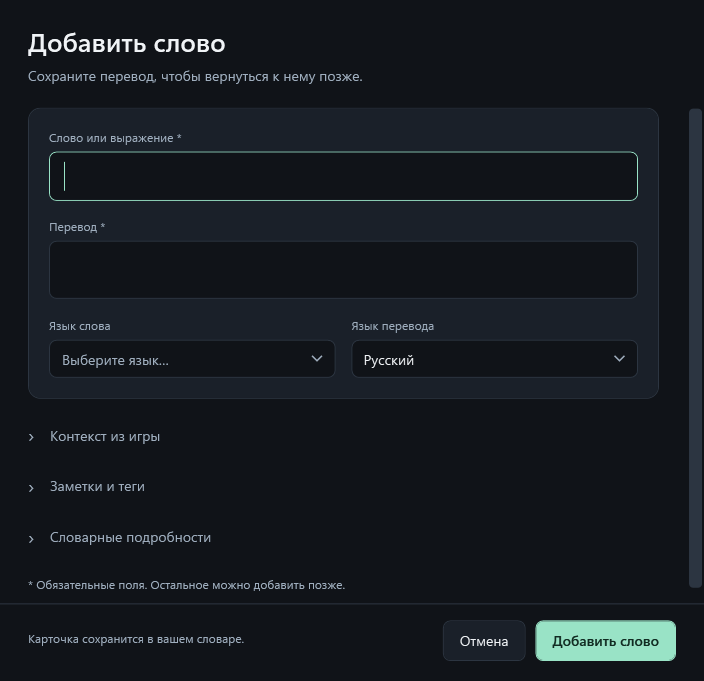

# GaameTranslate 0.2.3

Нативный экранный переводчик для Windows: перевод поверх игры, слово под курсором, контекстный словарь, озвучка и карточки для повторения. C# / .NET 10 / WPF.

## Запуск

Запустите `artifacts/publish/win-x64/GaameTranslate.exe`. В распакованном ZIP запускайте `GaameTranslate.exe` из корня папки. Оставьте все файлы рядом с EXE. Откройте «Настройки → Перевод», выберите сервис и нажмите «Проверить подключение». Проверка использует введённые параметры без их сохранения. Когда всё готово, нажмите «Сохранить».

## Настройки

Шесть вкладок: «Перевод», «Экран», «Словарь», «Клавиши», «Игры» и «Приложение». Дополнительные параметры раскрываются по необходимости. Кнопки сохранения и отмены всегда находятся внизу; отмена возвращает последние сохранённые значения. Черновик сохраняется при переходах между страницами приложения, но не после завершения процесса.

Поля подключения зависят от сервиса. Введённые ключи остаются в черновике при переключении сервисов и записываются только кнопкой «Сохранить». Помощник объяснений выбирается во вкладке «Словарь». В «Экране» есть предпросмотр размера и подложки текста; для записи сочетания нажмите на поле во вкладке «Клавиши». На время ввода глобальные сочетания приложения приостанавливаются; Tab или Escape завершает ввод.

Для открытия сразу на настройках: `GaameTranslate.exe --settings` при новом запуске.

## Мой словарь

Слева — сохранённые слова, справа — перевод выбранной карточки, контекст игры, объяснение и заметки. Поиск работает по слову, переводу, контексту, заметкам и тегам; доступны фильтр языка и сортировка. «Файлы и Anki» содержит импорт CSV, экспорт видимых карточек и синхронизацию всего словаря с Anki. «Повторить слова» открывает повторение карточек.

«Добавить слово» открывает отдельную форму с переводом и выбором языков. Контекст, заметки, теги и словарные подробности раскрываются по необходимости. Сохранение и отмена всегда внизу. При автоматическом определении языка в настройках язык ручной карточки нужно выбрать явно. Двойной щелчок по карточке открывает редактирование. Для открытия словаря при новом запуске: `GaameTranslate.exe --vocabulary`.





- **Alt+Q** — перевести экран поверх оригинала; повторное нажатие закрывает слой.
- **Alt+W** — распознать слово под курсором и открыть его в контексте реплики.
- В словаре сначала появляется перевод выбранного слова из сохранённых карточек, кэша или выбранного переводчика. Реплика и уточнение помощника загружаются после первого результата; слово можно сохранить сразу. Закрытие окна или изменение слова отменяет его фоновые запросы. Выбранная модель PP-OCRv6 заранее готовится при запуске приложения, без захвата экрана.
- **Ctrl+Shift+T** — выделить область; **Ctrl+Shift+R** — повторить её.
- **Ctrl+Shift+O** — показать/скрыть перевод; **Ctrl+Shift+I** — переключить пропуск нажатий в игру.
- В экранном слое «Выбрать слово / перевод» показывает оригинал с точными областями слов. Нажмите на слово для словаря. Колесо меняет размер шрифта.
- «Автоперевод области / Стоп» на странице Translate следит за выбранной областью. Изменившийся текст переводится заново; ошибка останавливает цикл. Захват запускается только явно.
- Escape закрывает активное окно перевода. Полностью завершить приложение можно через трей → Exit.

По умолчанию сервис — LibreTranslate на `http://127.0.0.1:5000`; он должен быть запущен отдельно. Можно выбрать любой из сервисов ниже. На новой установке переводческие модели не входят в ZIP.

## Сервисы

| Сервис | Подключение |
|---|---|
| Yandex Translate | Ключ Cloud Translate или IAM-токен. Для пользовательского IAM нужен ID каталога. API-ключ сервисного аккаунта отправляется без folderId. |
| YandexGPT | Ключ AI Studio, ID каталога и доступ к модели. Пустая модель использует `gpt://<каталог>/aliceai-llm`. |
| GigaChat | Authorization key (Base64 client_id:client_secret), OAuth scope и модель. Токен обновляется автоматически. |
| Ollama | Локальный сервер и имя установленной модели. |
| OpenAI compatible | Адрес API и ID модели: например LM Studio или совместимый облачный сервис. Для удалённого сервера нужен ключ. |
| LibreTranslate | Работающий сервер, адрес и необязательный ключ. |
| Azure | Ключ Translator и регион ресурса. |
| DeepL Free / Pro | Соответствующий API-ключ; доступность зависит от региона. |

Яндекс и GigaChat используют официальные API, отдельные от пользовательских сайтов/подписок. Нужны аккаунт, права и квота соответствующего API. Проверка TLS включена; для GigaChat может понадобиться доверенный сертификат в Windows.

Ключи защищены Windows DPAPI и сохраняются отдельно для сервисов. Пустое поле оставляет ключ; переключение сервиса очищает только введённое поле. HTTP разрешён для localhost; удалённые адреса требуют HTTPS. Автоматического перенаправления текста в другой сервис нет.

Официальные протоколы: [Yandex Translate](https://aistudio.yandex.ru/en/docs/translate/api-ref/Translation/translate), [Yandex AI Studio](https://aistudio.yandex.ru/ru/docs/ai-studio/quickstart/), [GigaChat](https://developers.sber.ru/docs/ru/gigachat/api/reference/rest/gigachat-api), [Ollama](https://docs.ollama.com/api/chat), [LibreTranslate](https://docs.libretranslate.com/).

## Локальные модели без Docker

Из PowerShell в проекте или корне распакованного ZIP:

```powershell
./scripts/Start-LocalModels.ps1 -Assistant
```

Скрипт скачивает портативный Ollama с официального GitHub и модели TranslateGemma 4B и Qwen3 4B. Требуется несколько гигабайт загрузки и свободного места. Файлы находятся в `artifacts/tools/ollama` и `artifacts/models/ollama`; сервер слушает только `127.0.0.1:11434`. Повторный запуск использует установленный сервер и модели.

В «Настройки → Перевод» выберите Ollama, адрес `http://127.0.0.1:11434`, модель `qwen3:4b-instruct-2507-q4_K_M` для контекстного перевода или `translategemma:4b` для специализированного перевода. Качество зависит от модели: локальная модель может неверно переводить термины и идиомы. Для объяснений во вкладке «Словарь» выберите помощника Ollama и модель `qwen3:4b-instruct-2507-q4_K_M`. TranslateGemma не используется как словарный помощник.

Модели устанавливаются отдельно и подчиняются собственным лицензиям. Скрипт не создаёт автозапуск Windows. После перезагрузки выполните его снова.

## Распознавание и экранный перевод

- PP-OCRv6 Small / Medium встроены и работают локально на CPU или с автоматическим ускорением Vulkan. Модели поддерживают английский, японский и китайский.
- Для остальных явно выбранных языков используется Windows OCR. Установите нужный OCR-пакет в параметрах языка Windows. Автоматический режим PP-OCR не предназначен для распознавания кириллицы.
- Части строки, разорванные подсветкой, сначала соединяются. Затем строки объединяются в реплики; новые говорящие и раздельные колонки сохраняются.
- Слова имеют координаты из CTC-выравнивания и языковую сегментацию Windows. Японский/китайский текст можно исправить или выбрать подстрокой.
- Четыре режима: Floating, Spatial, Replacement, SidePanel. Экранный перевод Alt+Q использует Replacement: цвет фона берётся с изображения, шрифт подбирается по реплике.
- Можно зафиксировать изображение под переводом. Это визуальный стоп-кадр: игровой процесс продолжает работать.
- Профили сохраняют настройки для имени игрового .exe и применяются перед захватом, если включена опция.
- Опциональный XInput: LB+RB+Y — экранный перевод; LB+RB+X — повтор области; LB+RB+B — показать/скрыть слой.

## Словарь и обучение

Словарное окно показывает перевод реплики и выбранного слова, определение, произношение, часть речи, примеры и синонимы, если они есть в источнике. «Объяснить в контексте» обращается к выбранному помощнику; такие статьи помечены как AI. Неизвестные сведения не выдаются за проверенный словарь. Озвучка использует установленные WinRT/SAPI-голоса Windows.

Импортируются Yomitan ZIP, DSL, текстовый StarDict (.ifo с соседними .idx/.dict, также .gz/.dz), Kaikki JSONL и CC-CEDICT TXT. Импорт транзакционный; ошибочный файл не заменяет ранее импортированные статьи. Дополнительный английский Free Dictionary API включается отдельно.

Карточка сохраняет контекст, определение, примеры, объяснение и, по отдельным опциям, локальный PNG/WAV. По умолчанию снимки и звук не сохраняются. Карточки редактируются, фильтруются и повторяются с расписанием Again / Hard / Good / Easy.

CSV сохраняет расширенные поля и принимает прежний восьмиколоночный формат. Снимки/звук остаются отдельными файлами. Экспорт Anki APKG включает медиа; TSV также доступен. AnkiConnect синхронизирует все сохранённые слова по устойчивым ID, обновляет поля существующих заметок и помечает отсутствующие тегом `GaameTranslate::removed`, сохраняя расписание. Нужны запущенный Anki и дополнение AnkiConnect 2055492159. Это отдельная модель заметок от APKG; не используйте оба способа для одной колоды, если хотите избежать параллельных коллекций.

## Данные

По умолчанию: `%LOCALAPPDATA%/GaameTranslate`. Настройки, игровые профили, SQLite-словарь и история, импортированные словари и опциональные медиа хранятся локально. Текст SQLite и медиа не зашифрованы. Телеметрии нет. Облачный сервис получает распознанный текст и поддерживаемый контекст при запрошенном переводе/объяснении. Изображения в переводческие API не отправляются.

История ограничена 500 записями; её можно выключить и очистить отдельно. Снимок последнего захвата держится в памяти для экранного слоя и опциональной карточки. Автозахват работает только после явного запуска и прекращается при Стоп, ошибке или завершении приложения.

## Сборка и проверка

Windows 11 x64, .NET 10 SDK для разработки; опубликованная папка содержит runtime. Предпочтительны оконные/borderless игры. Защищённый и эксклюзивный полноэкранный контент может препятствовать захвату/оверлею. Внедрения в игру и чтения её памяти нет.

```powershell
./scripts/Build.ps1 -Configuration Release -NativeVerification
./scripts/Publish.ps1
# artifacts/GaameTranslate-0.2.3-win-x64.zip
```

Реальные проверки и ограничения описаны в [TESTING](docs/TESTING.md), [изменениях 0.2](docs/RELEASE-0.2.md) и [сопоставлении функций](docs/LOOKUPPER-COMPARISON.md). Утверждения о превосходстве над Lookupper пока нет: его нужно подтвердить на одинаковом наборе игровых кадров.
